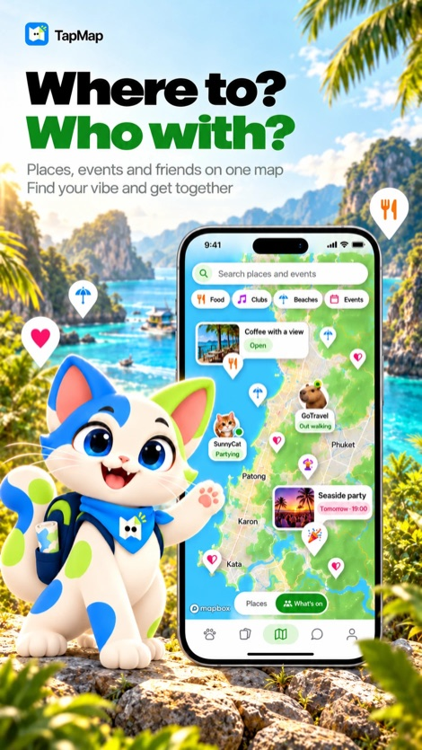
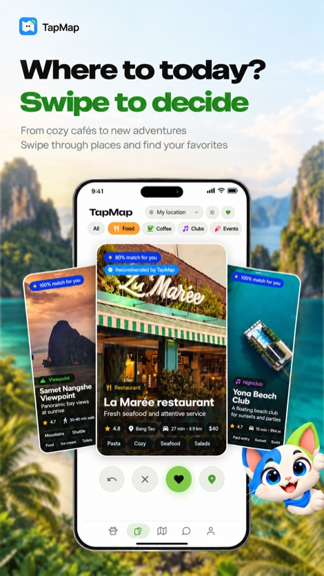
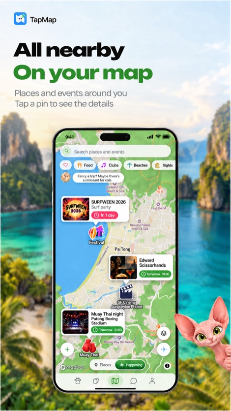
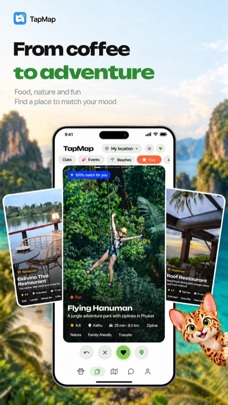
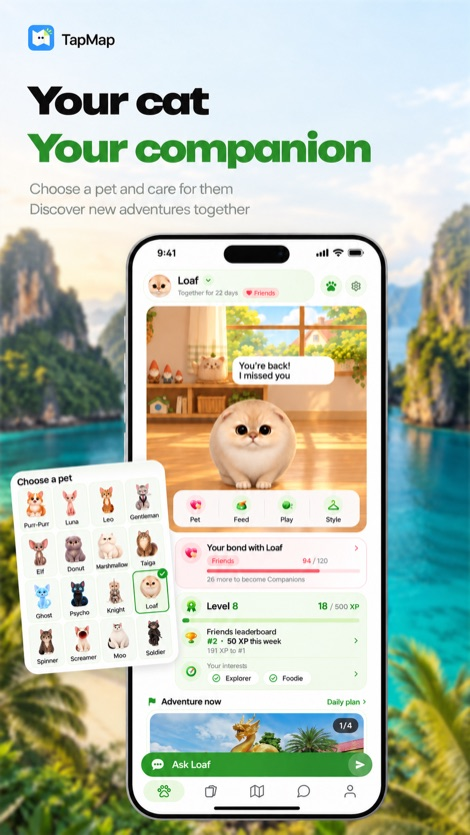

  

<h1 align="center">TapMap — where to go and who with</h1>

  A social network built on a map: restaurants, cafes, bars, nightclubs, beaches, 
  sights, spas and events in Phuket, Bangkok, Pattaya, Koh Samui, Chiang Mai and more cities.

  <a href="https://tapmap.net/?utm_source=github&utm_medium=readme">Website</a> ·
  <a href="https://play.google.com/store/apps/details?id=com.tapmap.psyhosoft&utm_source=github&utm_medium=readme">Google Play</a> ·
  <a href="https://tapmap.net/en/c/phuket?utm_source=github&utm_medium=readme">Phuket guide</a> ·
  <a href="README.ru.md">Русский</a>

  
  
  
  
  

> This repository holds information about TapMap — what it is, where to get it and
> how to reach us. The app's source code is private and is not published here.

## What TapMap does

- **One live map of the city.** Restaurants, cafes, bars, nightclubs, beaches, sights,
  nature, massage and spa, shopping and coworking spaces — the whole guide lives on
  your phone, so the map opens instantly and keeps working on a weak connection.
- **A deck of places.** Swipe right to save, left to skip. TapMap learns what you like
  and picks places to match your taste.
- **Detailed place cards.** A short summary of guest reviews, why to go, what to order,
  menus with prices and dish photos, average bill, opening hours and directions.
- **Events and cinema.** Parties, concerts, festivals and movie showtimes — by date and
  right on the map.
- **Friends on the map.** Share your location only with people you trust, chat
  one-on-one or in groups, make voice and video calls.
- **City chats.** Ask people who are already there where to eat or which beach is calm today.
- **Your own maps.** Collect favourite places into maps and share them with friends.
- **Routes and navigation.** Plan a route and see what's worth a stop on the way.
- **A cat companion** that lives on the map, levels up as you go out and collects a
  passport of cities.

Available in English, Russian and Thai. Free, with no ads inside.

## Get TapMap

| Platform | Link |
|---|---|
| Android | [Google Play](https://play.google.com/store/apps/details?id=com.tapmap.psyhosoft&utm_source=github&utm_medium=readme) |
| iPhone | App Store — in review |
| Web | [tapmap.net](https://tapmap.net/?utm_source=github&utm_medium=readme) — the full app in the browser |

## City guides on the web

Ranked by rating and number of reviews, updated from the same data as the app:

- [Things to do in Phuket](https://tapmap.net/en/c/phuket)
- [Restaurants and cafes in Phuket](https://tapmap.net/en/c/phuket/food) ·
  [Bars](https://tapmap.net/en/c/phuket/bars) ·
  [Nightclubs & beach clubs](https://tapmap.net/en/c/phuket/clubs) ·
  [Beaches](https://tapmap.net/en/c/phuket/beaches)
- [Sights](https://tapmap.net/en/c/phuket/attractions) ·
  [Nature](https://tapmap.net/en/c/phuket/nature) ·
  [Spa and massage](https://tapmap.net/en/c/phuket/spa) ·
  [Night markets & malls](https://tapmap.net/en/c/phuket/shopping) ·
  [Coworking](https://tapmap.net/en/c/phuket/coworking) ·
  [Events](https://tapmap.net/en/c/phuket/events)

More cities are on the way.

## FAQ

**Which cities does TapMap cover?**
Phuket and Bangkok have the most places and events right now; Pattaya, Koh Samui,
Chiang Mai and other cities are on the map too, and new cities and countries are coming.

**Does the map work without good internet?**
Yes. After the first launch the places live on your phone, so the map opens right away
even on a weak connection. Chats, calls, friends and fresh events need the internet.

**Who can see my location?**
Only the people you allow. In *Profile → Location privacy* you choose which friends see
you and how precisely, or hide completely.

**How much does it cost?**
Nothing. TapMap is free, with no subscriptions and no ads inside.

## Follow us

[Telegram](https://t.me/tap_map_dev) ·
[Instagram](https://www.instagram.com/tap.map.app/) ·
[X](https://x.com/TapMapOfficial) ·
[TikTok](https://www.tiktok.com/@tap_map) ·
[Pinterest](https://www.pinterest.com/tapmap_app/)

## Contact and legal

- Support: [support@tapmap.net](mailto:support@tapmap.net) · [Help page](https://tapmap.net/support-en.html)
- [Privacy policy](https://tapmap.net/privacy-en.html) · [Terms of use](https://tapmap.net/terms-en.html)

© Psyhosoft. TapMap name, logo, texts and images are not licensed for reuse.
