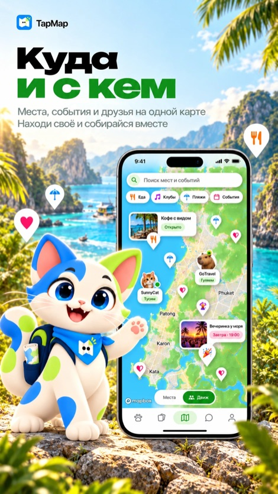
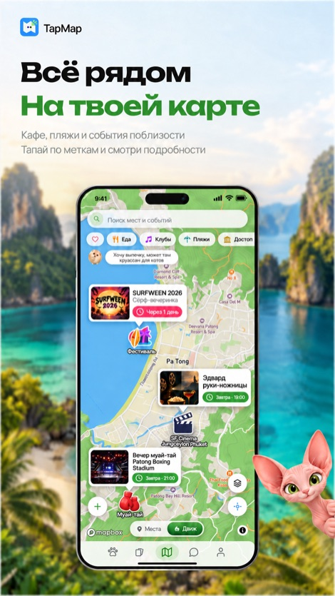
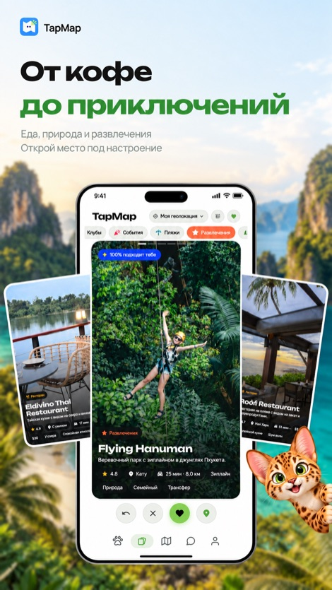
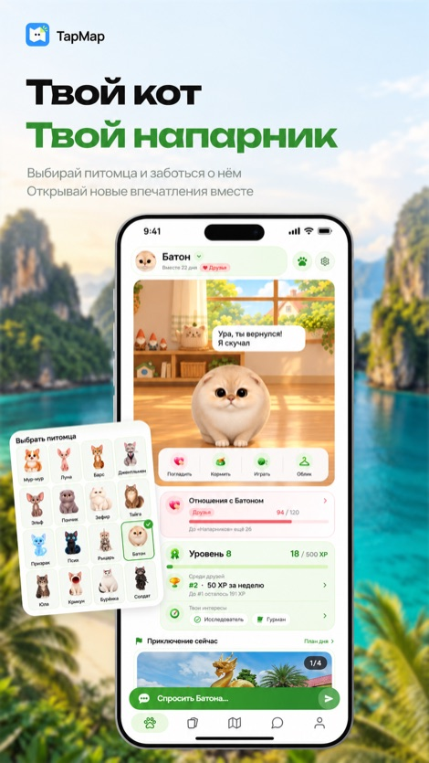

  

<h1 align="center">TapMap — куда и с кем</h1>

  Социальная сеть, построенная на карте: рестораны, кафе, бары, клубы, пляжи, 
  достопримечательности, SPA и афиша Пхукета, Бангкока, Паттайи, Самуи, Чиангмая и других городов.

  <a href="https://tapmap.net/?utm_source=github&utm_medium=readme">Сайт</a> ·
  <a href="https://play.google.com/store/apps/details?id=com.tapmap.psyhosoft&utm_source=github&utm_medium=readme">Google Play</a> ·
  <a href="https://www.rustore.ru/catalog/app/com.tapmap.psyhosoft">RuStore</a> ·
  <a href="https://tapmap.net/c/phuket?utm_source=github&utm_medium=readme">Гид по Пхукету</a> ·
  <a href="README.md">English</a>

  
  
  
  
  

> В этом репозитории — информация о TapMap: что это, где скачать и как с нами
> связаться. Исходный код приложения закрыт и здесь не публикуется.

## Что умеет TapMap

- **Одна живая карта города.** Рестораны, кафе, бары, клубы, пляжи,
  достопримечательности, природа, массаж и SPA, шопинг и коворкинги. Вся база в
  телефоне: карта открывается сразу и работает даже на слабом интернете.
- **Колода мест.** Вправо — сохранить, влево — дальше. TapMap запоминает, что тебе
  нравится, и подбирает места под твой вкус.
- **Подробные карточки.** Сводка по отзывам гостей, за чем идти, что заказать, меню с
  ценами и фото блюд, средний чек, часы работы и дорога.
- **Афиша и кино.** Вечеринки, концерты, фестивали и сеансы — по датам и прямо на карте.
- **Друзья на карте.** Делись геолокацией только с теми, кому доверяешь, переписывайся
  в личных и групповых чатах, звони и созванивайся по видео.
- **Чаты городов.** Спроси у тех, кто уже на месте, где поесть и на каком пляже сегодня
  нет волн.
- **Свои карты.** Собирай подборки любимых мест и делись ими с друзьями.
- **Маршрут и навигация.** Проложи путь и посмотри, что интересного по дороге.
- **Кот-компаньон** живёт на карте, растёт от твоих походов и собирает паспорт городов.

Интерфейс на русском, английском и тайском. Бесплатно, без рекламы внутри.

## Скачать

| Платформа | Ссылка |
|---|---|
| Android | [Google Play](https://play.google.com/store/apps/details?id=com.tapmap.psyhosoft&utm_source=github&utm_medium=readme) |
| Android | [RuStore](https://www.rustore.ru/catalog/app/com.tapmap.psyhosoft) |
| iPhone | App Store — на проверке |
| Браузер | [tapmap.net](https://tapmap.net/?utm_source=github&utm_medium=readme) — приложение целиком |

## Гиды по городам

Лучшие места по оценке и числу отзывов, из тех же данных, что в приложении:

- [Куда сходить на Пхукете и что посмотреть](https://tapmap.net/c/phuket)
- [Рестораны и кафе Пхукета](https://tapmap.net/c/phuket/food) ·
  [Бары](https://tapmap.net/c/phuket/bars) ·
  [Ночные клубы](https://tapmap.net/c/phuket/clubs) ·
  [Пляжи](https://tapmap.net/c/phuket/beaches)
- [Достопримечательности](https://tapmap.net/c/phuket/attractions) ·
  [Природа](https://tapmap.net/c/phuket/nature) ·
  [SPA и массаж](https://tapmap.net/c/phuket/spa) ·
  [Рынки и торговые центры](https://tapmap.net/c/phuket/shopping) ·
  [Коворкинги](https://tapmap.net/c/phuket/coworking) ·
  [Афиша](https://tapmap.net/c/phuket/events)

Скоро — другие города.

## Вопросы и ответы

**В каких городах работает TapMap?**
Больше всего мест и событий сейчас на Пхукете и в Бангкоке; Паттайя, Самуи, Чиангмай
и другие города тоже на карте, скоро — новые города и страны.

**Работает ли карта без хорошего интернета?**
Да. После первого запуска база мест хранится в телефоне, поэтому карта открывается
сразу и на слабой связи. Интернет нужен для чатов, звонков, друзей и свежих событий.

**Кто видит моё местоположение?**
Только те, кому вы разрешили. В «Профиль → Приватность геолокации» можно выбрать, кто
из друзей и насколько точно видит вас на карте, или скрыться полностью.

**Сколько стоит TapMap?**
Нисколько: приложение бесплатное, без подписок и без рекламы внутри.

## Мы в соцсетях

[Telegram](https://t.me/tap_map_dev) ·
[Instagram](https://www.instagram.com/tap.map.app/) ·
[X](https://x.com/TapMapOfficial) ·
[TikTok](https://www.tiktok.com/@tap_map) ·
[Pinterest](https://www.pinterest.com/tapmap_app/)

## Связь и документы

- Поддержка: [support@tapmap.net](mailto:support@tapmap.net) · [страница помощи](https://tapmap.net/support.html)
- [Политика конфиденциальности](https://tapmap.net/privacy.html) · [Условия использования](https://tapmap.net/terms.html)

© Psyhosoft. Название, логотип, тексты и изображения TapMap не лицензируются для повторного использования.
